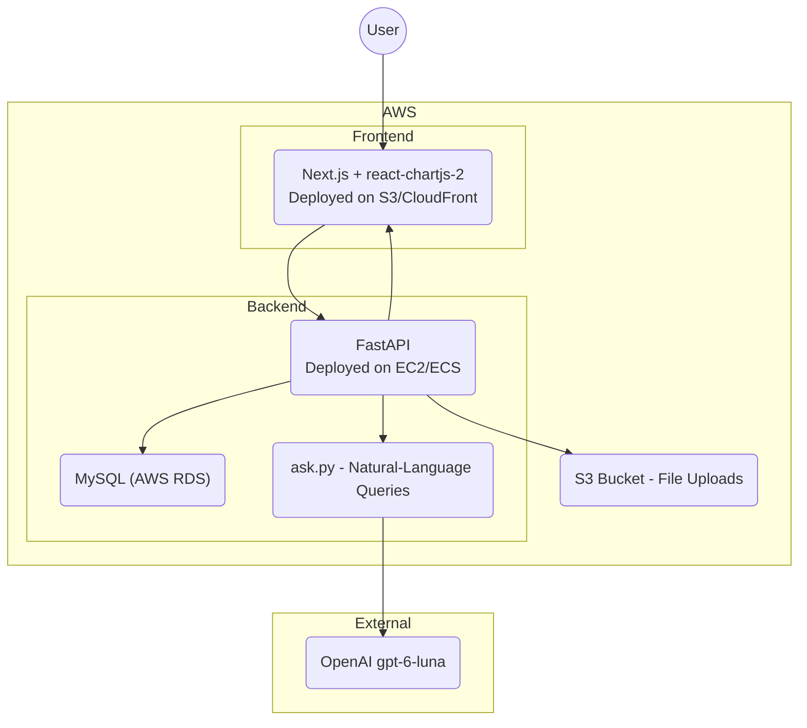

# AWS Cost Analyzer

[](LICENSE)
[] [] []

## Overview

AWS Cost Analyzer lets you upload billing reports (CSV / Excel), store and aggregate costs in a local MySQL database, then ask natural-language questions to gain insights and optimization suggestions using OpenAI's **gpt-6-luna**.

## Tech Stack

- **Backend**: Python 3.10+, FastAPI, Uvicorn, Pandas
- **Database**: MySQL 8+
- **Frontend**: Next.js (React), Tailwind CSS
- **LLM**: OpenAI `gpt-6-luna` (override via `OPENAI_MODEL` env var)
- **Charts**: Chart.js, react-chartjs-2

## Architecture



## Features

- CSV and Excel (`xls`, `xlsx`) upload & parsing
- Raw (`cost_data`) and aggregated (`cost_summary`) storage
- Natural-language Q&A → SQL → summarization
- Interactive cost breakdown charts

## Installation

```bash
git clone https://github.com/aniketkarne/AI-aws-cloud-cost-analyzer.git
cd AI-aws-cloud-cost-analyzer
```

Backend:

```bash
cd backend
python3 -m venv venv
source venv/bin/activate
pip install -r requirements.txt
cp ../.env.example .env   # then edit .env with your OPENAI_API_KEY and MySQL creds
```

Frontend:

```bash
cd ../frontend
npm install
```

## Usage

Start Backend (from the `backend/` directory):

```bash
uvicorn backend.main:app --reload --host 0.0.0.0 --port 8000
# or, equivalently:
python main.py
```

Start Frontend (from the `frontend/` directory):

```bash
npm run dev
```

Open <http://localhost:3000>.

## Configuration

Required environment variables (see `.env.example`):

- `OPENAI_API_KEY` — your OpenAI API key
- `OPENAI_MODEL` — (optional) defaults to `gpt-6-luna`
- `DB_HOST`, `DB_PORT`, `DB_USER`, `DB_PASS`, `DB_NAME` — MySQL connection

The backend auto-creates the `aws_costs` database and the `cost_data` /
`cost_summary` tables on first start.

## Project Structure

```
.
├── backend
│   ├── main.py             # FastAPI app + startup hooks
│   ├── db.py               # MySQL connection + schema bootstrap
│   ├── sql_safety.py       # LLM-SQL sanitizer (read-only whitelist)
│   ├── routes
│   │   ├── upload.py       # POST /upload
│   │   └── ask.py          # POST /ask (NL → SQL → answer)
│   └── requirements.txt
├── tests
│   ├── conftest.py
│   ├── test_sql_safety.py  # unit tests for the sanitizer
│   ├── test_ask_endpoint.py # integration tests for /ask (mocked OpenAI + MySQL)
│   └── test_upload_endpoint.py # /upload filename safety + temp cleanup
├── frontend
│   ├── pages
│   │   ├── index.tsx
│   │   ├── upload.tsx
│   │   └── ask.tsx
│   ├── components
│   │   └── CostChart.tsx
│   ├── styles
│   │   └── globals.css
│   ├── tailwind.config.js
│   └── package.json
├── .env.example
├── .gitignore
├── LICENSE
├── pytest.ini
└── README.md
```

## Testing

The suite covers the LLM-SQL sanitizer (read-only whitelist, multi-
statement truncation, comment handling) and the `/ask` endpoint
handling of hostile LLM outputs:

```bash
cd backend
pip install -r requirements.txt pytest httpx
cd ..
pytest -q
```

CI runs the same suite on Python 3.10 and 3.12 via
`.github/workflows/tests.yml`. No MySQL or OpenAI key is required to
run the suite; both are mocked.

## Security note on `/ask`

The `/ask` endpoint generates a SQL query from your natural-language
question via the OpenAI API and runs it against your local MySQL
database. Any SQL the LLM emits is passed through
`backend.sql_safety.sanitize_llm_sql` before execution: markdown fences
are stripped, only the first statement is kept, and only `SELECT`,
`WITH`, or `SHOW` are allowed — anything else is rejected with HTTP
400. A `WITH` statement must end in a `SELECT` main statement (MySQL
permits CTEs before writes), and `INTO OUTFILE` / `INTO DUMPFILE` are
rejected anywhere in the statement. Scanning is string-literal aware,
so legitimate queries containing `;`, `--` or `#` inside quoted strings
pass through intact. This is defense-in-depth. Run the backend with a
dedicated MySQL user that has only `SELECT` on `cost_data` and
`cost_summary` for real protection.

## Contributing

Contributions are welcome. Please open issues or submit pull requests.

## License

[MIT](LICENSE)